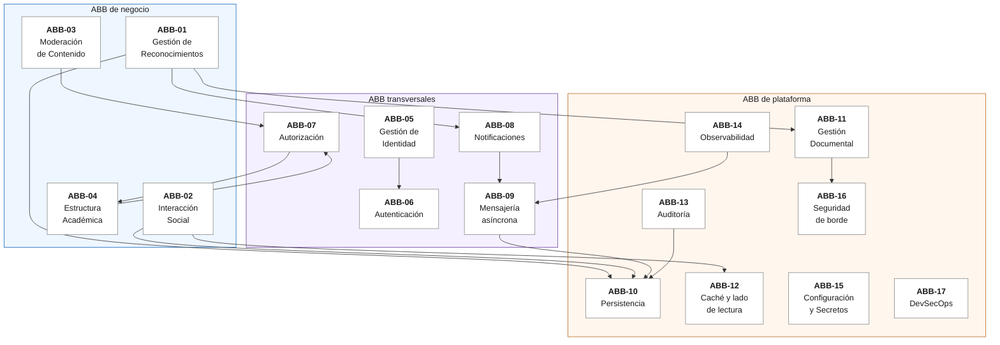

# Architecture Building Blocks y Solution Building Blocks

Un **ABB** (Architecture Building Block) es una capacidad que la arquitectura necesita, expresada sin tecnología: «hace falta poder notificar a alguien». Un **SBB** (Solution Building Block) es la pieza concreta que materializa ese ABB: «un adaptador de WhatsApp Cloud API detrás de un puerto».

La distinción importa porque los ABB salen de los drivers y son estables, mientras los SBB son sustituibles. Que esta plataforma pueda cambiar de proveedor de correo sin tocar el dominio (QA-MANT-01) es exactamente eso: cambiar el SBB conservando el ABB.

El enunciado pide que la selección de SBB considere **costos, complejidad, escalabilidad, riesgos, mantenibilidad y evolución futura**. Cada ABB de abajo trae esa evaluación.

## 1. Mapa de ABB

## 2. Catálogo de ABB

Cada ABB se justifica por el driver o el requisito que lo obliga. Un ABB sin driver que lo exija no debería existir.

| ABB | Capacidad | Lo exige | Alcance (ADR-0019) |
|---|---|---|---|
| **ABB-01** Gestión de Reconocimientos | Crear, clasificar y consultar Kudos con adjuntos | RF-07, RF-08, RF-13, DRV-002 | Nivel 1 |
| **ABB-02** Interacción Social | Réplicas anidadas y calificaciones | RF-09, RF-10 | Nivel 2 |
| **ABB-03** Moderación de Contenido | Reportar y vetar, con cascada | RF-11, RF-12 | Nivel 2 |
| **ABB-04** Estructura Académica | Facultades, programas y la relación de personas con ellos | RF-05, y es el ámbito de la autorización | Nivel 1 (mínima) |
| **ABB-05** Gestión de Identidad | Personas, roles, jerarquía, ciclo de vida de la cuenta | RF-01 a RF-04, DRV-005 | Nivel 1 |
| **ABB-06** Autenticación | Probar quién es alguien sin custodiar contraseñas | DRV-005 | Nivel 1 |
| **ABB-07** Autorización | Decidir qué puede hacer cada rol, y sobre qué ámbito | RF-03, RF-06, RF-12, DRV-005 | Nivel 1 |
| **ABB-08** Notificaciones | Avisar por correo, WhatsApp y push, con una sola política | RF-14 a RF-16, DRV-003 | Nivel 1 |
| **ABB-09** Mensajería asíncrona | Desacoplar la transacción de sus efectos externos, sin perder ni duplicar | RF-07, QA-CONF-01, QA-CONF-02, QA-DISP-01 | Nivel 1 |
| **ABB-10** Persistencia | Fuente de verdad transaccional con invariantes defendidas | Todos | Nivel 1 |
| **ABB-11** Gestión Documental | Guardar, proteger, recuperar y trazar los adjuntos | RF-08, DRV-004 | Nivel 1 |
| **ABB-12** Caché y lado de lectura | Responder la carga de consulta sin castigar la escritura | DRV-002, QA-REND-01 | Nivel 1 |
| **ABB-13** Auditoría | Registro inalterable de quién hizo qué | RF-17, DRV-006 | Nivel 1 |
| **ABB-14** Observabilidad | Métricas, trazas y logs correlacionados | RF-18, DRV-006 | Nivel 1 |
| **ABB-15** Configuración y Secretos | Un artefacto por entorno, secretos fuera del repositorio | DRV-005, RT-06 | Nivel 1 |
| **ABB-16** Seguridad de borde | TLS, superficie mínima y validación de entrada | DRV-005 | Nivel 1 |
| **ABB-17** DevSecOps | Calidad y seguridad verificadas en cada cambio | DRV-007, RT-03, RT-04 | Nivel 1 |

### ABB que el enunciado sugiere y aquí no se adoptan

El enunciado da una lista de ABB «posibles». Dos no se adoptan, y conviene decir por qué en lugar de dejarlos sin mencionar:

| ABB sugerido | Por qué no |
|---|---|
| **Logging** como ABB propio | Se absorbe en ABB-14. Separar «logging» de «observabilidad» invita a tratar los logs como un fin, cuando su valor está en correlacionarse con las trazas (ADR-0014). Además la auditoría, que es lo que suele confundirse con el logging, es un ABB aparte (ABB-13) porque sirve para rendir cuentas y no para diagnosticar |
| **Mensajería** como ABB separado de Notificaciones | Sí se adopta, pero como ABB-09 y con un alcance preciso: no es «un bus de mensajes», es «desacoplar una transacción de sus efectos externos». Esa precisión es la que permite descartar un broker con argumentos (ADR-0005) |

## 3. SBB seleccionados y su justificación

Evaluación según los seis criterios del enunciado.

### ABB-06 Autenticación → proveedor OIDC externo en capa gratuita

| Criterio | Evaluación |
|---|---|
| **Costo** | Cero: capa gratuita suficiente para el volumen de una universidad |
| **Complejidad** | Baja: la API es un validador de token, no un servidor de identidad |
| **Escalabilidad** | La del proveedor, superior a cualquier cosa que se construya aquí |
| **Riesgos** | Dependencia externa: si está caído, nadie entra. Aceptable frente a custodiar contraseñas, y el enunciado no fija objetivo de disponibilidad para el inicio de sesión |
| **Mantenibilidad** | Alta: no hay código de contraseñas que mantener ni auditar |
| **Evolución** | Cambiar de proveedor es cambiar emisor y audiencia, porque la autorización no depende de él (ADR-0004) |

**SBB descartado:** Keycloak autoalojado. Es técnicamente el más completo, pero consume memoria de la única máquina y modelar la jerarquía dentro del proveedor la sacaría del dominio, donde es el corazón del enunciado.

### ABB-07 Autorización → servicio de dominio propio

| Criterio | Evaluación |
|---|---|
| **Costo** | Cero, es código propio |
| **Complejidad** | Media: hay que modelar nivel y ámbito. Es complejidad **del problema**, no añadida |
| **Escalabilidad** | Una consulta de una fila por petición, con índice |
| **Riesgos** | Es código propio de seguridad, así que hay que probarlo bien. Se mitiga con pruebas unitarias sobre la tabla de casos del flujo de aprobaciones |
| **Mantenibilidad** | Alta: las reglas de RF-03, RF-04, RF-06 y RF-12 están en un sitio |
| **Evolución** | Añadir un rol es una fila de catálogo, no un cambio de código |

**SBB descartado:** roles en los claims del token. Es lo habitual y aquí falla dos veces: el ámbito por facultad y programa no cabe de forma mantenible en un token, y un rol en el token no se puede revocar antes de que expire.

### ABB-08 Notificaciones → gateway propio con un adaptador por canal

| Criterio | Evaluación |
|---|---|
| **Costo** | Cero el gateway; los canales, en capa gratuita |
| **Complejidad** | Media, concentrada en un módulo en lugar de repartida por todos |
| **Escalabilidad** | Limitada por las cuotas de los proveedores, no por el diseño |
| **Riesgos** | Las cuotas gratuitas y la aprobación de plantillas de WhatsApp. Se miden y se declaran |
| **Mantenibilidad** | Alta: las reglas de cada proveedor se escriben una vez |
| **Evolución** | Un canal nuevo es un adaptador más y una fila en la política (ADR-0006) |

**SBB descartado:** plataforma omnicanal externa. Resolvería lo mismo añadiendo un intermediario y un costo sin ningún driver que lo pida.

### ABB-09 Mensajería asíncrona → bandeja de salida en la misma base

| Criterio | Evaluación |
|---|---|
| **Costo** | Cero: ninguna pieza nueva que desplegar |
| **Complejidad** | Baja: una tabla y un proceso en segundo plano |
| **Escalabilidad** | Suficiente para el volumen de una universidad. `SKIP LOCKED` permite varias instancias sin duplicar envíos |
| **Riesgos** | Usar la base como cola no escala indefinidamente. El punto de cambio está identificado |
| **Mantenibilidad** | Alta: se depura con SQL, no con la consola de un broker |
| **Evolución** | La bandeja está detrás de un puerto: sustituir el transporte no toca el dominio |

**SBB descartado para esta línea base:** RabbitMQ o Kafka. Es la evolución natural, pero hoy añade un contenedor que consume memoria de la única máquina gratuita, otra superficie que escanear y otra pieza que explicar, sin driver que lo exija (ADR-0005).

### ABB-11 Gestión Documental → almacenamiento compatible con S3, autoalojado y privado

| Criterio | Evaluación |
|---|---|
| **Costo** | Cero: un contenedor en la máquina que ya existe |
| **Complejidad** | Baja: el adaptador usa una API estándar |
| **Escalabilidad** | Limitada por el disco de la máquina. Suficiente, y migrable |
| **Riesgos** | Hay **dos** sistemas que respaldar de forma coordinada. Un respaldo de uno sin el otro deja Kudos con adjuntos inexistentes |
| **Mantenibilidad** | Alta, por ser una API estándar |
| **Evolución** | **La razón de elegir compatibilidad con S3**: migrar a un servicio gestionado es cambiar tres variables de configuración |

**SBB descartado:** guardar el archivo en una columna binaria de la base. Es lo más simple de programar y lo peor de operar: infla los respaldos y llena la caché del motor con datos que nadie consulta.

### ABB-12 Caché y lado de lectura → consultas propias y caché en memoria invalidada por evento

| Criterio | Evaluación |
|---|---|
| **Costo** | Cero |
| **Complejidad** | Media: hay dos caminos de acceso a los datos que mantener de acuerdo |
| **Escalabilidad** | La caché en memoria no sirve con varias instancias. Está detrás de un puerto: el cambio es de adaptador |
| **Riesgos** | Los contadores materializados pueden quedar desfasados si una escritura los omite. Se mitiga manteniéndolos en la misma transacción y con una consulta de verificación en las pruebas |
| **Mantenibilidad** | Media: la invalidación debe declararse en un solo lugar o aparecen datos viejos |
| **Evolución** | Primero caché distribuida, después réplica de lectura (ADR-0010) |

**SBB descartado hoy:** réplica de lectura de PostgreSQL. Duplicaría el consumo de la única máquina, y el cuello de botella hay que demostrarlo antes de pagarlo.

### Resto de los SBB

| ABB | SBB | Nota de justificación |
|---|---|---|
| ABB-01, ABB-02, ABB-03, ABB-04, ABB-05 | Módulos propios en las capas de dominio y aplicación | Es el negocio del enunciado: no se compra, se escribe |
| ABB-10 Persistencia | PostgreSQL con mapeo explícito y migraciones versionadas | Las reglas de unicidad de RF-04 son restricciones de integridad, y un motor relacional las defiende donde no se pueden eludir (ADR-0003) |
| ABB-13 Auditoría | Tabla de solo inserción con cadena de hashes, en la misma base | La atomicidad con el hecho auditado exige la misma transacción, lo que descarta cualquier servicio externo (ADR-0013) |
| ABB-14 Observabilidad | OpenTelemetry con recolector autoalojado | Estándar abierto: el destino es configuración. Una plataforma gestionada no cabe en presupuesto cero y es un riesgo el día de la sustentación (ADR-0014) |
| ABB-15 Configuración y Secretos | Variables de entorno sin valor por omisión, archivo de entorno con permisos restringidos | Lo correcto sería un gestor de secretos dedicado, que es lo único que da auditoría de acceso. Descartado por costo, con el camino abierto (ADR-0018) |
| ABB-16 Seguridad de borde | Proxy inverso con TLS automático, un solo puerto expuesto | Suficiente para el alcance. Un WAF sería la evolución si la plataforma quedara expuesta a tráfico real (ADR-0016) |
| ABB-17 DevSecOps | GitHub Actions con análisis estático, escaneo de vulnerabilidades y de secretos | Obligatorio por RT-03 y RT-04; gratuito con repositorio público (ADR-0017) |

## 4. Matriz completa de ABB a SBB

| ABB | SBB elegido | SBB descartado principal | ADR |
|---|---|---|---|
| ABB-01 Reconocimientos | Módulo Kudos propio | — | ADR-0001 |
| ABB-02 Interacción | Árbol con ruta materializada | Documento anidado en JSON | ADR-0011 |
| ABB-03 Moderación | Veto en cascada por prefijo | Veto individual | ADR-0011 |
| ABB-04 Académica | Tablas propias | — | ADR-0003 |
| ABB-05 Identidad | Modelo propio de personas y roles | — | ADR-0004 |
| ABB-06 Autenticación | Proveedor OIDC en capa gratuita | Keycloak autoalojado | ADR-0004 |
| ABB-07 Autorización | Servicio de dominio propio | Roles en los claims | ADR-0004 |
| ABB-08 Notificaciones | Gateway propio, un adaptador por canal | Plataforma omnicanal externa | ADR-0006 |
| ABB-08a Correo | SMTP con proveedor transaccional | API propietaria del proveedor | ADR-0008 |
| ABB-08b WhatsApp | Meta Cloud API, número de prueba, por plantilla | Twilio Sandbox | ADR-0007 |
| ABB-08c Push | SSE + Web Push con VAPID | Firebase Cloud Messaging | ADR-0009 |
| ABB-09 Mensajería | Bandeja de salida en PostgreSQL | RabbitMQ o Kafka | ADR-0005 |
| ABB-10 Persistencia | PostgreSQL con mapeo explícito | MongoDB; dominio anotado | ADR-0003 |
| ABB-11 Documental | Compatible con S3, privado, servido por la API (sin URL prefirmada: revisado el 2026-11-13) | Columna binaria en la base | ADR-0012 |
| ABB-12 Caché y lectura | CQRS ligero, contadores, caché por evento | CQRS con base separada | ADR-0010 |
| ABB-13 Auditoría | Solo inserción con cadena de hashes | Historial automático del ORM | ADR-0013 |
| ABB-14 Observabilidad | OpenTelemetry, recolector autoalojado | Plataforma gestionada | ADR-0014 |
| ABB-15 Configuración | Variables de entorno, sin valor por omisión | Archivo versionado | ADR-0018 |
| ABB-16 Borde | Proxy inverso con TLS automático | WAF | ADR-0016 |
| ABB-17 DevSecOps | Pipeline con puertas bloqueantes | Escaneos manuales | ADR-0017 |

## 5. El criterio que decidió casi todo

Repasando la tabla, hay un patrón que conviene nombrar: en **cinco** de los ABB (09, 11, 12, 15, 16) el SBB «correcto en producción» se descartó por costo o por plazo, y en los cinco la decisión fue la misma: **elegir una abstracción estándar que deje la puerta abierta**.

- La bandeja está detrás de un puerto, así que un broker entra sin tocar el dominio.
- El almacenamiento habla la API de S3, así que un servicio gestionado entra cambiando configuración.
- La caché está detrás de un puerto, así que una caché distribuida es otro adaptador.
- La configuración entra por variables de entorno, así que un gestor de secretos es un adaptador de configuración.

Eso es lo que hace que estas decisiones sean arquitectura y no atajos: la contrapartida está identificada, el punto de cambio está nombrado y el costo de cambiar es conocido.
