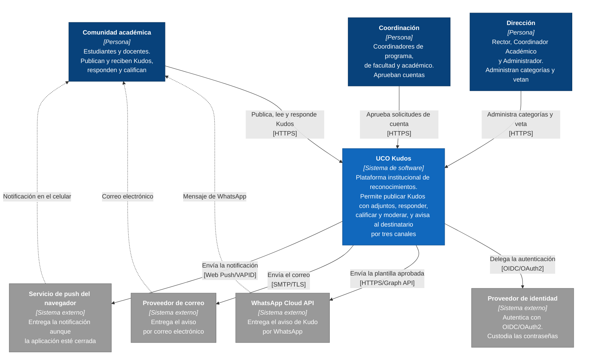
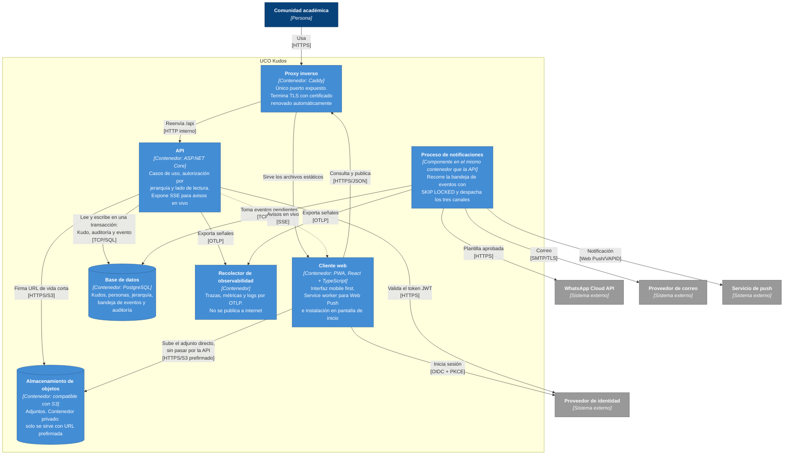

# Diseño de alto nivel — modelo C4 niveles 1 y 2

Los diagramas usan la **notación C4** (tipo de elemento, tecnología, descripción y los colores estándar del modelo) dibujada sobre `flowchart` de Mermaid, no sobre la sintaxis `C4Context` nativa: esa última ignora el acomodo pedido y traza líneas por encima de las cajas, así que el resultado es ilegible. La notación se respeta; el motor de dibujo es el que cambia.

## 1. Nivel 1 — Diagrama de contexto

Qué es el sistema y con quién habla. Un solo bloque para UCO Kudos, las personas que lo usan y los sistemas externos de los que depende.

### Qué se lee en este diagrama

| Observación | Consecuencia arquitectónica |
|---|---|
| Hay **un** sistema, no varios | No hay microservicios: es un monolito modular (ADR-0001) |
| La plataforma **no custodia contraseñas** | Toda una clase de vulnerabilidades queda fuera (ADR-0004) |
| Los tres canales de aviso son **sistemas externos**, lentos y falibles | Publicar un Kudo no puede depender de ellos: de ahí la bandeja de eventos (ADR-0005) |
| Los tres grupos de personas son **el mismo tipo de usuario** con distinto rol | No hay aplicaciones separadas por rol: una sola interfaz que muestra lo que corresponde (ADR-0004, ADR-0015) |
| Las flechas de vuelta son punteadas | El aviso llega **fuera** de la sesión del usuario: el destinatario puede no estar conectado (ADR-0009) |

## 2. Nivel 2 — Diagrama de contenedores

Las unidades que se despliegan y ejecutan, y cómo se comunican. Es el nivel donde se ven las decisiones de ADR-0005, ADR-0010, ADR-0012 y ADR-0016.

### Contenedores

| Contenedor | Tecnología | Responsabilidad | ADR |
|---|---|---|---|
| Cliente web | PWA en React y TypeScript | Interfaz mobile first; service worker para Web Push | ADR-0015 |
| Proxy inverso | Caddy | Único puerto expuesto a internet; TLS automático; sirve los estáticos y reenvía la API | ADR-0016 |
| API | ASP.NET Core | Casos de uso, autorización por jerarquía, lado de lectura y SSE | ADR-0001, ADR-0004 |
| Proceso de notificaciones | Servicio en segundo plano | Recorre la bandeja y despacha los tres canales | ADR-0005, ADR-0006 |
| Base de datos | PostgreSQL | Única fuente de verdad, bandeja de eventos y auditoría | ADR-0003 |
| Almacenamiento de objetos | Compatible con S3 | Adjuntos, privados y servidos con URL prefirmada | ADR-0012 |
| Recolector de observabilidad | Recolector OTLP | Trazas, métricas y logs | ADR-0014 |

### Dos cosas de este diagrama que hay que saber defender

**El proceso de notificaciones vive dentro del contenedor de la API.** No es un contenedor aparte, y está dibujado así a propósito. Es un servicio en segundo plano del mismo proceso, que es lo que corresponde a un monolito modular (ADR-0001): separarlo exigiría otra imagen, otra unidad que desplegar y otra que vigilar, sin ningún driver que lo pida. El `SKIP LOCKED` de la bandeja ya permite que, si en el futuro se levantan varias instancias, ninguna procese el mismo evento que otra (QA-ELAS-01), así que la decisión no cierra la puerta a separarlo.

**El cliente sube los adjuntos directamente al almacenamiento**, no a través de la API, usando una URL prefirmada que la API emite **después** de comprobar permisos (ADR-0012). Así los megabytes de una foto no atraviesan la aplicación, que es lo que importa en la red móvil del 90 % de los usuarios (DRV-001). La autorización sigue estando en la API: el almacenamiento solo honra una firma.

## 3. Trazabilidad con los drivers

| Driver | Dónde se ve en estos diagramas |
|---|---|
| DRV-001 Movilidad | El cliente es una PWA, y la subida de adjuntos evita la API |
| DRV-002 Lectura masiva | La API tiene un lado de lectura propio, separado del de escritura |
| DRV-003 Multicanal | El proceso de notificaciones habla con los tres sistemas externos de aviso |
| DRV-004 Adjuntos | Almacenamiento de objetos como contenedor propio, privado |
| DRV-005 Seguridad | Un solo puerto expuesto; identidad delegada; almacenamiento no publicado |
| DRV-006 Observabilidad | El recolector recibe señales de la API y del proceso |
| DRV-007 Automatización | No aparece aquí: es el diagrama de despliegue el que muestra el pipeline |
