# Diagrama de componentes

Nivel 3 del modelo C4: qué hay dentro del contenedor de la API. Es el diagrama donde se ve Clean Architecture (ADR-0001) y por qué las dependencias apuntan todas hacia el centro.

## 1. Componentes del contenedor de la API

```mermaid
flowchart TB
    cliente["<b>Cliente web</b><br/><i>[Contenedor]</i>"]

    subgraph interfaces["Capa de interfaces — UcoKudos.Api"]
        direction LR
        endpoints["<b>Endpoints HTTP</b><br/><i>[Componente]</i><br/>Reciben la petición, validan la forma<br/>y llaman a un puerto de entrada.<br/>Solo conocen puertos y DTO"]
        manejador["<b>Manejador de excepciones</b><br/><i>[Componente]</i><br/>Traduce ExcepcionDominio a 400,<br/>el conflicto a 409 y la autorización<br/>a 403, con el id de traza"]
        sse["<b>Canal de avisos en vivo</b><br/><i>[Componente]</i><br/>Mantiene abierta una conexión SSE<br/>por usuario conectado"]
        salud["<b>Puntos de salud</b><br/><i>[Componente]</i>"]
    end

    subgraph aplicacion["Capa de aplicación — UcoKudos.Application"]
        direction TB
        casos["<b>Casos de uso</b><br/><i>[Componentes]</i><br/>PublicarKudo, ResponderKudo, Calificar,<br/>AprobarSolicitud, AdministrarCategoria,<br/>VetarContenido, CargarAdjunto"]
        consultas["<b>Lado de lectura</b><br/><i>[Componente]</i><br/>Consultas del muro y de los hilos.<br/>Devuelve lo que la pantalla necesita,<br/>sin materializar entidades"]
        gateway["<b>Gateway de notificaciones</b><br/><i>[Componente]</i><br/>Política de canal por tipo de aviso.<br/>Deduplica por evento y destinatario"]
        catalogo["<b>Catálogo de mensajes</b><br/><i>[Componente]</i><br/>Textos en es-CO y sus variables,<br/>fuera del código"]
        puertosSalida["<b>Puertos de salida</b><br/><i>[Interfaces]</i><br/>IUnidadTrabajo, IBandejaSalida,<br/>IEnviadorCorreo, IWhatsAppGateway,<br/>IEnviadorPush, IAlmacenObjetos, ICache"]
    end

    subgraph dominio["Capa de dominio — UcoKudos.Domain"]
        direction LR
        entidades["<b>Entidades y objetos de valor</b><br/><i>[Componentes]</i><br/>Kudo, Replica, Persona, AsignacionRol,<br/>Categoria, Calificacion, Adjunto.<br/>Validan sus invariantes al construirse"]
        servicios["<b>Servicios de dominio</b><br/><i>[Componentes]</i><br/>JerarquiaInstitucional (quién aprueba<br/>y manda sobre quién), ReglasModeracion,<br/>RutaReplica"]
        repos["<b>Puertos de repositorio</b><br/><i>[Interfaces]</i><br/>IKudoRepositorio, IPersonaRepositorio,<br/>IReplicaRepositorio, IAuditoriaRepositorio"]
    end

    subgraph infraestructura["Capa de infraestructura — UcoKudos.Infrastructure"]
        direction TB
        persistencia["<b>Adaptadores de persistencia</b><br/><i>[Componentes]</i><br/>Repositorios, mapeo explícito,<br/>migraciones y UnidadTrabajo"]
        proceso["<b>Proceso de notificaciones</b><br/><i>[Componente]</i><br/>Recorre la bandeja con SKIP LOCKED<br/>y reintenta con espera creciente"]
        adaptadores["<b>Adaptadores de los canales</b><br/><i>[Componentes]</i><br/>WhatsApp (Meta y simulado),<br/>Correo SMTP, Web Push, Avisos SSE"]
        objetos["<b>Adaptador de objetos</b><br/><i>[Componente]</i><br/>Firma URL de vida corta"]
        cache["<b>Caché en memoria</b><br/><i>[Componente]</i><br/>Cache-aside con invalidación por evento"]
        obs["<b>Instrumentación</b><br/><i>[Componente]</i><br/>OpenTelemetry; propaga la traza<br/>a través de la bandeja"]
    end

    bd[("<b>PostgreSQL</b>")]
    almacen[("<b>Objetos</b>")]
    externos["<b>Proveedores externos</b><br/><i>[Sistemas]</i><br/>Identidad, WhatsApp,<br/>correo y push"]

    cliente --> endpoints
    cliente -.-> sse
    endpoints --> casos
    endpoints --> consultas
    sse --> casos
    manejador -.->|"captura"| dominio

    casos --> entidades
    casos --> servicios
    casos --> repos
    casos --> puertosSalida
    consultas --> puertosSalida
    gateway --> catalogo
    gateway --> puertosSalida
    entidades --> servicios
    servicios --> repos

    persistencia -.->|"implementa"| repos
    persistencia -.->|"implementa"| puertosSalida
    adaptadores -.->|"implementa"| puertosSalida
    objetos -.->|"implementa"| puertosSalida
    cache -.->|"implementa"| puertosSalida
    proceso --> gateway

    persistencia --> bd
    proceso --> bd
    objetos --> almacen
    adaptadores --> externos
    endpoints --> externos

    classDef capaDominio fill:#f5f0ff,stroke:#6b3fa0,color:#1a1a1a
    classDef capaAplicacion fill:#eef6ff,stroke:#1168bd,color:#1a1a1a
    classDef capaInfra fill:#fff6ee,stroke:#b5651d,color:#1a1a1a
    classDef capaInterfaces fill:#eefaf0,stroke:#2d7a3e,color:#1a1a1a
    classDef comp fill:#438dd5,stroke:#2e6295,color:#ffffff
    classDef iface fill:#8e5fc0,stroke:#5e3c80,color:#ffffff
    classDef externo fill:#999999,stroke:#6b6b6b,color:#ffffff
    class dominio capaDominio
    class aplicacion capaAplicacion
    class infraestructura capaInfra
    class interfaces capaInterfaces
    class endpoints,manejador,sse,salud,casos,consultas,gateway,catalogo,entidades,servicios,persistencia,proceso,adaptadores,objetos,cache,obs comp
    class puertosSalida,repos iface
    class cliente,bd,almacen,externos externo
```

## 2. Cómo leer las flechas

Hay dos tipos y la diferencia es el corazón de Clean Architecture:

- **Flecha continua: «usa».** Van siempre hacia dentro. Los endpoints usan casos de uso; los casos de uso usan entidades, servicios de dominio y puertos.
- **Flecha punteada «implementa»: va hacia dentro también**, y es la que invierte la dependencia. La infraestructura implementa interfaces que están declaradas en el dominio y en la aplicación. Por eso el dominio no sabe que existe PostgreSQL, y cambiar de proveedor de correo es escribir otro adaptador (QA-MANT-01).

**No hay ninguna flecha que salga del dominio hacia afuera.** Eso es lo que verifican las pruebas de arquitectura, y lo que el compilador ya impone porque cada capa es un proyecto (ADR-0001).

## 3. Responsabilidades, una por componente

| Componente | Responsabilidad única | No le corresponde |
|---|---|---|
| Endpoints HTTP | Traducir HTTP a una llamada de caso de uso | Decidir reglas de negocio ni de autorización de dominio |
| Manejador de excepciones | Traducir errores de negocio a códigos de estado | Conocer casos de uso concretos |
| Casos de uso | Orquestar dominio y puertos en una intención del negocio | Saber qué base de datos ni qué proveedor hay detrás |
| Lado de lectura | Devolver datos listos para la pantalla en una consulta | Aplicar reglas de escritura |
| Gateway de notificaciones | Elegir canal y mensaje, y deduplicar | Conocer los módulos emisores |
| Catálogo de mensajes | Guardar los textos y sus variables | Lógica |
| Entidades | Defender sus invariantes | Persistirse |
| Servicios de dominio | Reglas que abarcan varias entidades, como la jerarquía | Infraestructura |
| Adaptadores | Hablar con un sistema concreto | Reglas de negocio |
| Proceso de notificaciones | Tomar eventos y despacharlos con reintentos | Decidir el contenido del aviso, que es del gateway |

## 4. El componente que más conviene explicar

**`JerarquiaInstitucional`** es un servicio de dominio, no una tabla de permisos ni una configuración del proveedor de identidad. Responde exactamente dos preguntas:

1. *¿Quién aprueba a quién?* (RF-03) — un Estudiante lo aprueba el Coordinador de Programa; un Coordinador de Programa, el de Facultad; y así hasta el Administrador, que se aprueba a sí mismo.
2. *¿Sobre quién manda este usuario?* (RF-04 a RF-06, RF-12) — un Coordinador de Programa administra a los estudiantes y docentes **de sus programas**, no a todos.

Está en el dominio porque es la parte más característica del enunciado y la que más vale la pena poder probar con pruebas unitarias rápidas, sin base de datos ni red. Si viviera en el proveedor de identidad o en condicionales repartidos por los endpoints, ni se podría probar así ni se podría explicar en un sitio (ADR-0004).
