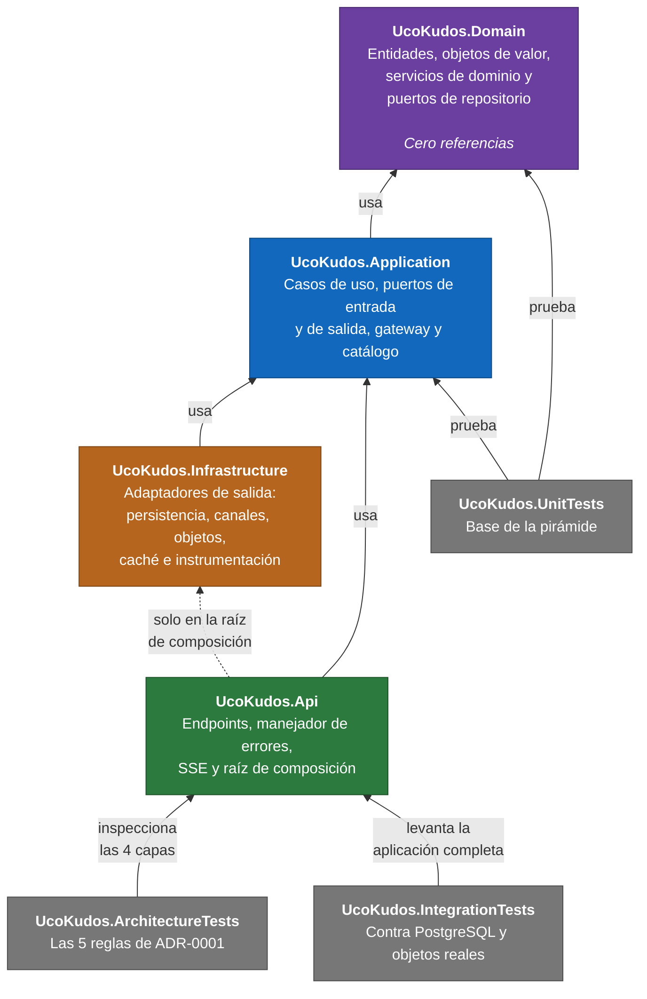
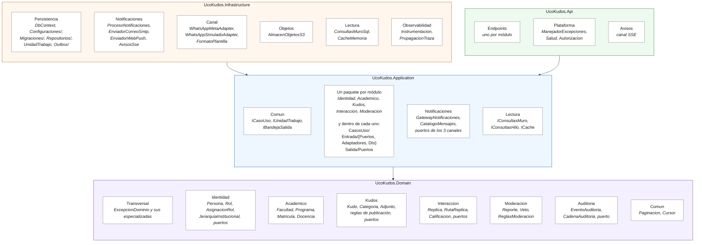

# Diagrama de paquetes

Organización del código en proyectos y espacios de nombres, y las dependencias permitidas entre ellos. Es la vista que corresponde una a una con las cinco reglas de ADR-0001, las mismas que verifican las pruebas de arquitectura.

## 1. Dependencias entre proyectos

Cada capa es un proyecto. Eso importa: la dirección de las dependencias la impone **el compilador**, no la convención. Una referencia en sentido contrario no compila.



La flecha punteada de `Api` a `Infrastructure` es la única excepción y está acotada: existe para que la raíz de composición registre los adaptadores. **Es la razón por la que las pruebas de arquitectura hacen falta**: el compilador ya garantiza las tres primeras reglas, pero esta referencia es legítima, así que solo una prueba puede comprobar que los endpoints no la aprovechen.

## 2. Paquetes internos

Dentro de cada capa, la organización es **por módulo primero y por tipo de pieza después**. Así, todo lo de Kudos está junto, y no repartido entre una carpeta de casos de uso y otra de DTO.



## 3. La estructura de un módulo de aplicación

Todos los módulos de `UcoKudos.Application` siguen la misma forma. Es el estilo de puertos y adaptadores acordado con el docente en el curso:

```text
Kudos/
├── CasosUso/
│   ├── PublicarKudoCasoUso.cs
│   ├── ConsultarMuroCasoUso.cs
│   └── CargarAdjuntoCasoUso.cs
├── Entrada/
│   ├── Puertos/
│   │   └── IKudosPuertoEntrada.cs      ← lo que la API puede llamar
│   ├── Adaptadores/
│   │   └── KudosAdaptadorEntrada.cs    ← implementa el puerto llamando a los casos de uso
│   └── Dto/
│       ├── PublicarKudoDto.cs
│       └── KudoDto.cs
└── Salida/
    └── Puertos/
        └── IAlmacenAdjuntos.cs         ← lo que el módulo necesita de afuera
```

Por qué este reparto:

- **`Entrada/Puertos` es el contrato hacia la API.** Un endpoint depende de la interfaz, nunca de un caso de uso concreto. Eso permite que la regla 4 de ADR-0001 sea verificable.
- **`Entrada/Adaptadores`** reúne varios casos de uso detrás de un puerto, así que la API tiene una sola dependencia por módulo en lugar de una por operación.
- **`Salida/Puertos`** declara lo que el módulo necesita. Está **en el módulo que lo necesita**, no en una carpeta común de interfaces: así se ve de un vistazo de qué depende cada módulo.
- **Los DTO viven aquí, no en el dominio.** Una entidad nunca cruza hacia la API.

## 4. Reglas de dependencia, y quién las hace cumplir

| Regla de ADR-0001 | Quién la impone |
|---|---|
| 1. El dominio no depende de ninguna otra capa | El compilador (el proyecto no tiene referencias) y una prueba que lo guarda |
| 2. La aplicación depende solo del dominio | El compilador y una prueba que lo guarda |
| 3. La infraestructura no conoce la capa de interfaces | El compilador y una prueba que lo guarda |
| 4. La API solo usa puertos de entrada y DTO | **Solo la prueba de arquitectura**, porque la referencia a la infraestructura es legítima en la raíz de composición |
| 5. El núcleo no referencia tecnología de persistencia | Una prueba que inspecciona los ensamblados referenciados |
| Ningún módulo usa la implementación de un caso de uso de otro módulo | La prueba de arquitectura, cuando haya más de un módulo |

La regla 4 se comprobó provocando a propósito una violación: se añadió un uso de la infraestructura fuera de la raíz de composición, falló solo esa prueba y volvió a verde al retirarlo. Una regla que nunca ha fallado no está verificada.
