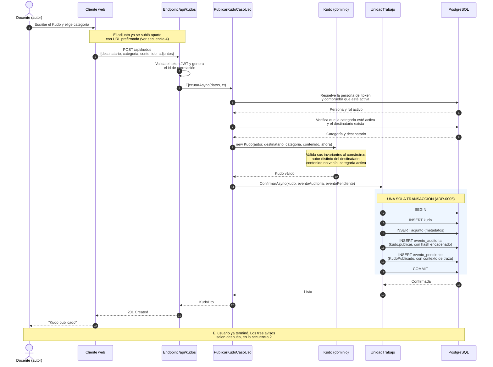
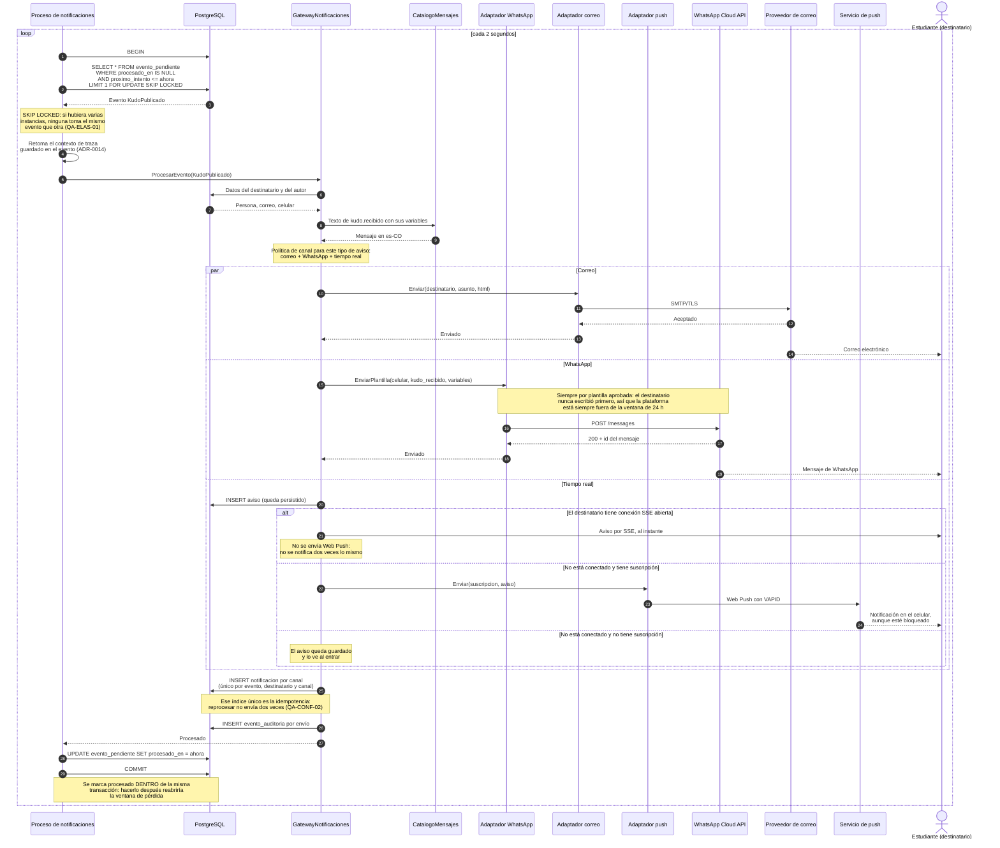
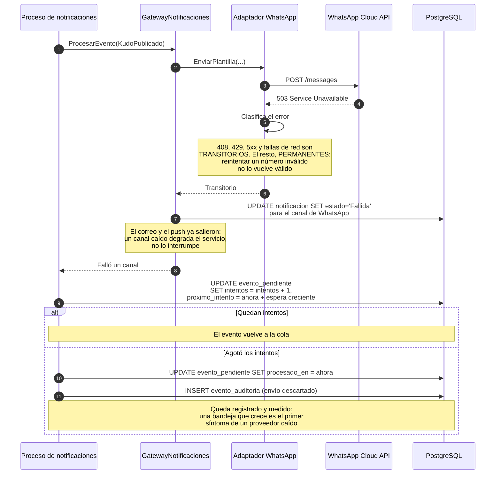
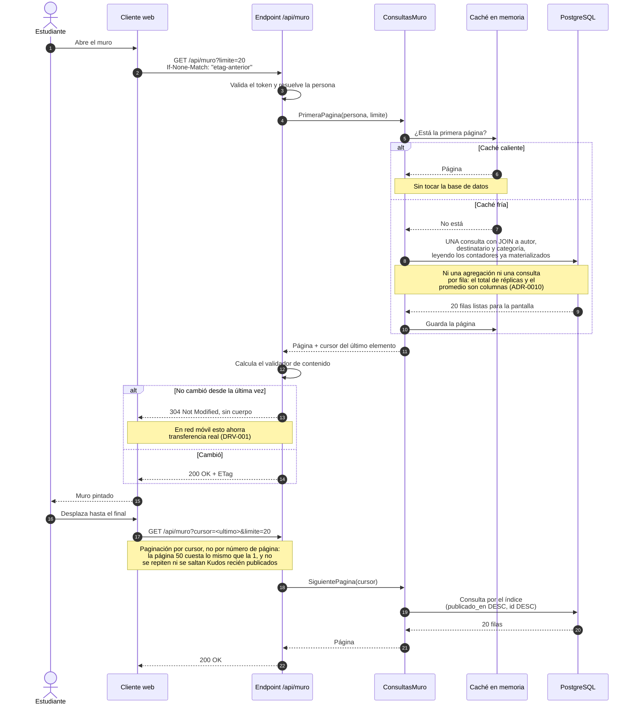
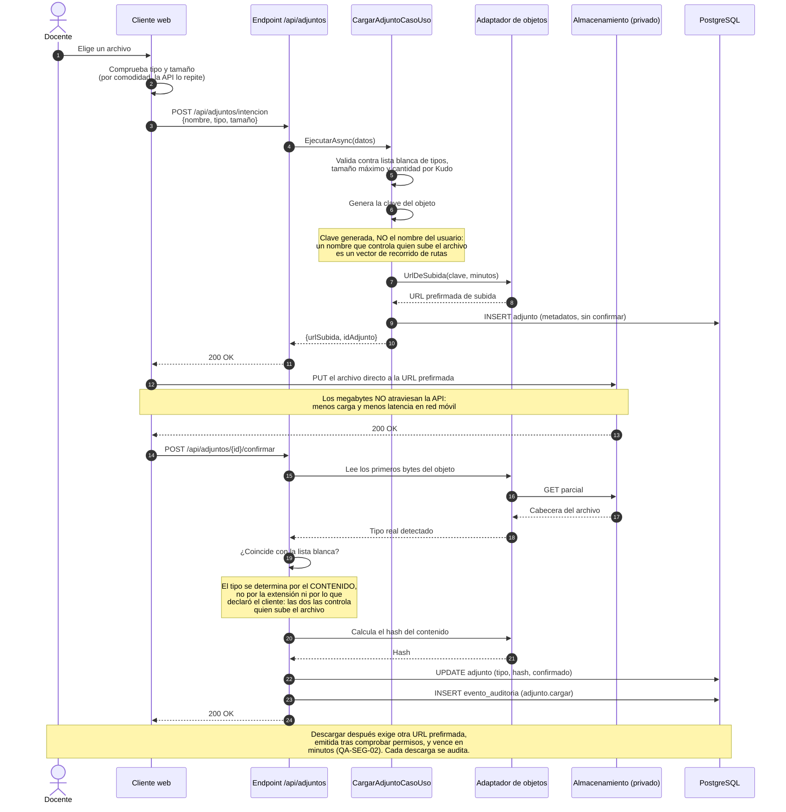
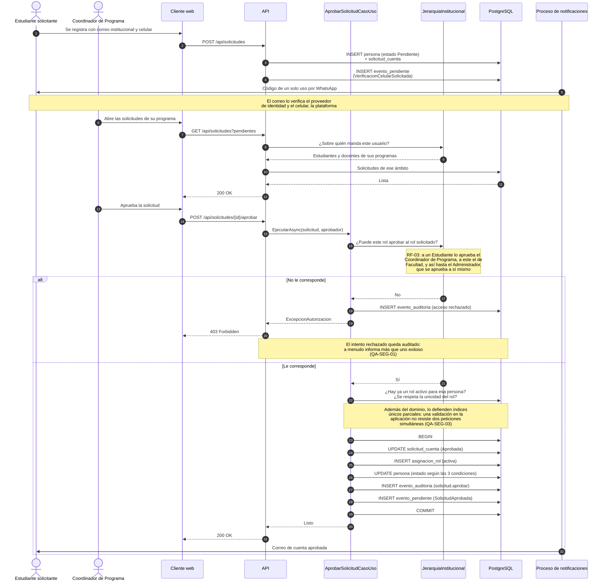
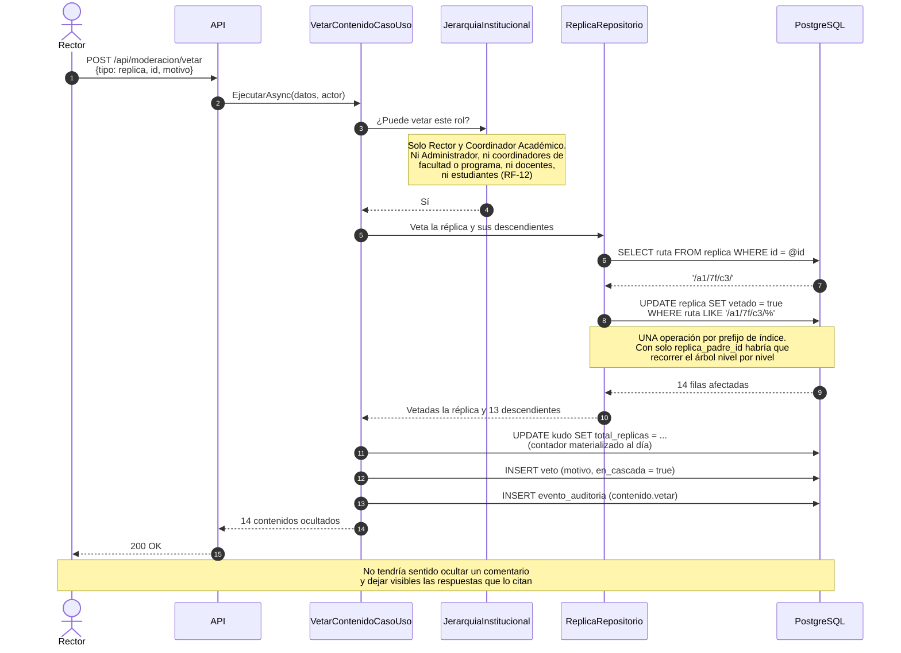

# Diagramas de secuencia

Los flujos críticos de la plataforma. El primero es el que el enunciado exige implementar completo (RF-07) y el que concentra las decisiones de ADR-0005, ADR-0006 y ADR-0013.

## 1. Publicar un Kudo — la transacción

Primera mitad del flujo obligatorio: lo que ocurre mientras el usuario espera. Nótese que **no se habla con ningún proveedor externo** en esta parte.

### Lo que hay que saber defender de esta secuencia

**Los cinco pasos del enunciado no ocurren todos aquí**, y es deliberado. En esta transacción ocurren el paso 1 (persistencia) y el paso 5 (auditoría). Los pasos 2, 3 y 4 ocurren en la secuencia siguiente.

Si los tres envíos se hicieran dentro de esta transacción, pasarían dos cosas malas: el usuario esperaría a tres servicios externos, y un 503 de Meta haría fallar la publicación de un Kudo que no tiene nada de malo. Eso contradice QA-DISP-01 y castiga la responsividad que DRV-001 exige en red móvil.

**El evento de auditoría y el evento pendiente se escriben en la misma transacción que el Kudo.** Si se confirma, se confirman los tres; si falla, no queda rastro de un cambio que no ocurrió. Esa atomicidad es lo que cierra la ventana «commit exitoso, envío perdido» que QA-CONF-01 describe.

## 2. Publicar un Kudo — los tres avisos

Segunda mitad. Ocurre en el proceso en segundo plano, segundos después y en otro hilo.

### Cómo responde al fallo

El Kudo quedó publicado y auditado desde la secuencia 1. **Meta caída no impide publicar** (QA-DISP-01).

## 3. Consultar el muro

El flujo más frecuente de la plataforma, y el que responde a DRV-002. Dos recorridos: con la caché caliente y sin ella.

Cuando alguien publica un Kudo, el evento de ADR-0005 **invalida la primera página** de la caché. Por eso la invalidación es por evento y no por expiración: no hay que elegir entre datos viejos y poca eficacia.

## 4. Cargar un adjunto

Responde a RF-08 y DRV-004, y muestra las cuatro estrategias de ADR-0012 en movimiento.

## 5. Aprobar una solicitud de cuenta

Responde a RF-02 y RF-03, y es donde se ve el servicio de dominio de la jerarquía.

## 6. Vetar contenido en cascada

Responde a RF-12 y muestra por qué la ruta materializada de ADR-0011 paga.

## 7. Resumen de trazabilidad

| Secuencia | Requisitos | Escenarios de calidad | ADR |
|---|---|---|---|
| 1. Publicar — transacción | RF-07, RF-17 | QA-CONF-01 | ADR-0005, ADR-0013 |
| 2. Publicar — avisos | RF-07, RF-14, RF-15, RF-16 | QA-CONF-02, QA-ELAS-01 | ADR-0005 a ADR-0009 |
| 2b. Fallo de un canal | RF-15 | QA-DISP-01 | ADR-0005, ADR-0007 |
| 3. Consultar el muro | RF-13 | QA-REND-01, QA-REND-02 | ADR-0010 |
| 4. Cargar un adjunto | RF-08 | QA-SEG-02 | ADR-0012 |
| 5. Aprobar una cuenta | RF-01, RF-02, RF-03, RF-04 | QA-SEG-01, QA-SEG-03 | ADR-0004 |
| 6. Vetar en cascada | RF-12 | — | ADR-0011 |
