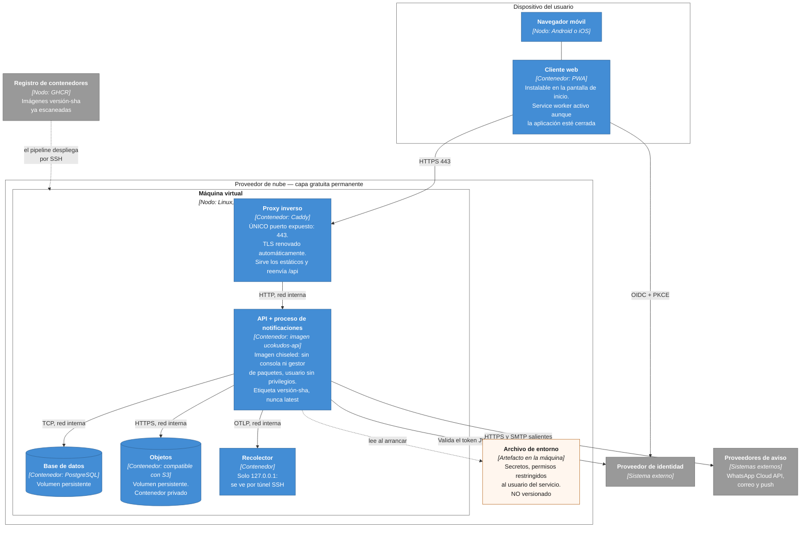
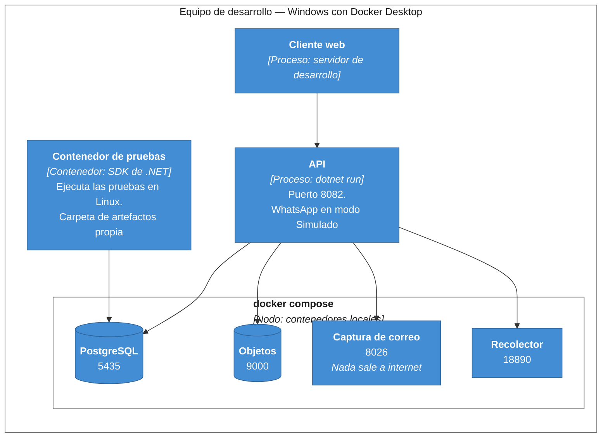
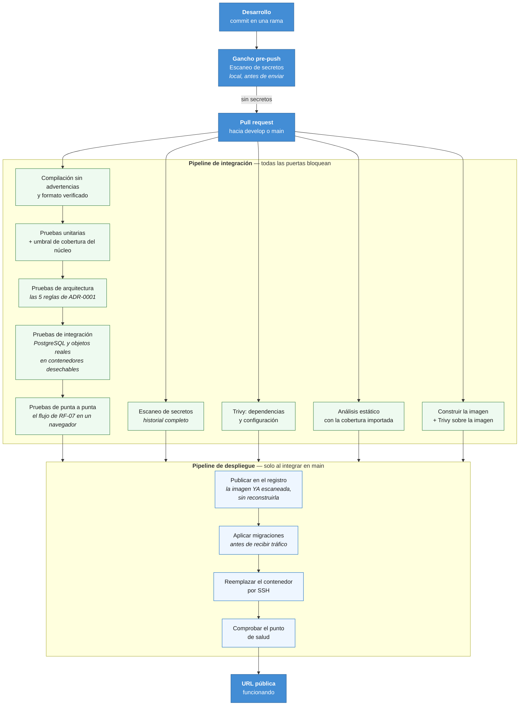

# Diagrama de despliegue

Dónde corre cada contenedor y cómo llega el código hasta ahí. Cubre ADR-0016 (infraestructura) y ADR-0017 (pipeline), y es el diagrama donde se ve DRV-007.

## 1. Despliegue en producción

Notación C4 de despliegue sobre `flowchart`: nodos de infraestructura con su tecnología, y dentro los contenedores que alojan.

### Decisiones que se leen en el diagrama

| Observación | Razón |
|---|---|
| **Una sola máquina virtual**, no una plataforma de aplicaciones | Las plataformas gratuitas suspenden el servicio por inactividad y tardan de 30 a 60 segundos en despertar. Durante una sustentación eso es el peor momento posible (ADR-0016) |
| **Un solo puerto expuesto**, el 443 | La base, los objetos y el recolector escuchan solo en la red interna de los contenedores. Para ver el recolector se usa un túnel |
| La API y el proceso de notificaciones están en **el mismo contenedor** | Es un monolito modular: el proceso es un servicio en segundo plano del mismo artefacto (ADR-0001) |
| El cliente sube los adjuntos **directo** al almacenamiento | Los megabytes no atraviesan la API, que importa en la red móvil del 90 % de los usuarios (DRV-001, ADR-0012) |
| HTTPS es **obligatorio**, no una mejora | El service worker de la PWA y la API de notificaciones solo funcionan sobre un origen seguro |
| La imagen lleva etiqueta `versión-sha` | Se despliega exactamente la imagen que el pipeline construyó y escaneó, no una reconstruida (ADR-0017) |
| El archivo de entorno está **fuera** de la imagen | Un artefacto para todos los entornos; lo que cambia es la configuración (ADR-0018, factor V) |

**Un único punto de fallo y ninguna redundancia.** Si la máquina cae, la plataforma cae. Para el alcance de la entrega es aceptable y hay que declararlo; la mitigación es el respaldo probado de la base y del volumen de objetos, con el mismo procedimiento, porque un respaldo de uno sin el otro deja Kudos que apuntan a adjuntos inexistentes.

## 2. Entorno local

La misma topología, con dos cambios: el correo se atrapa en lugar de enviarse, y no hay proxy porque la API se ejecuta directamente. Esa paridad es el factor X de los doce (ADR-0018).

**Las pruebas corren dentro de un contenedor.** No es una preferencia: en el equipo de desarrollo, Smart App Control está activo en modo bloqueo y rechaza cargar ensamblados recién compilados sin reputación, así que el ejecutor de pruebas muere antes de la primera prueba. El contenedor lo evita sin desactivar ninguna protección del sistema, que además sería irreversible. Tiene un segundo beneficio: es el mismo entorno Linux del pipeline, y de hecho el CI invoca el mismo script, así que un resultado local y uno del pipeline son comparables.

Los puertos están desplazados (5435 en lugar de 5432, 8082 en lugar de 8080) para poder tener varios entornos locales encendidos a la vez.

## 3. Del commit al servidor

El pipeline de ADR-0017. Todas las puertas bloquean: una puerta que solo informa es documentación, no una puerta.

### Dos detalles del pipeline que conviene poder explicar

**Se escanea la imagen y se publica exactamente la imagen escaneada**, sin reconstruirla. Reconstruir después de escanear invalida el escaneo: la imagen que llega al servidor no sería la que pasó la puerta.

**El escaneo de secretos corre dos veces, y el que importa es el local.** Detectar un secreto en el pipeline significa que ya está en el repositorio remoto, y borrarlo del archivo no lo saca del historial. El gancho antes del envío es el que lo evita de verdad.

**Las acciones externas van fijadas por el identificador de commit, no por etiqueta.** Una etiqueta se puede mover a código distinto, y es un vector real de ataque a la cadena de suministro.

## 4. Riesgos del despliegue

| Riesgo | Mitigación |
|---|---|
| La creación de la cuenta en el proveedor puede exigir verificación y tardar | Es la primera tarea del desarrollo, antes que cualquier otra de infraestructura |
| La región elegida puede tener agotada la capacidad de la capa gratuita | Probar otra región |
| El pipeline falla la mañana de la entrega | Hay procedimiento manual de despliegue documentado |
| Una demostración que solo funciona en la red de casa | Probar el flujo completo desde un celular con datos móviles, fuera de esa red, al menos un día antes |
| Recursos limitados con cinco contenedores | Vigilar la memoria. Es la razón por la que ADR-0005 descartó añadir un broker de mensajes |
