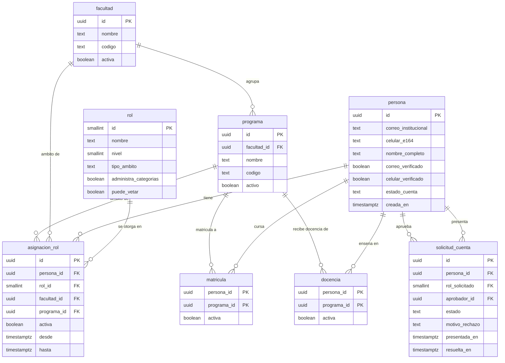
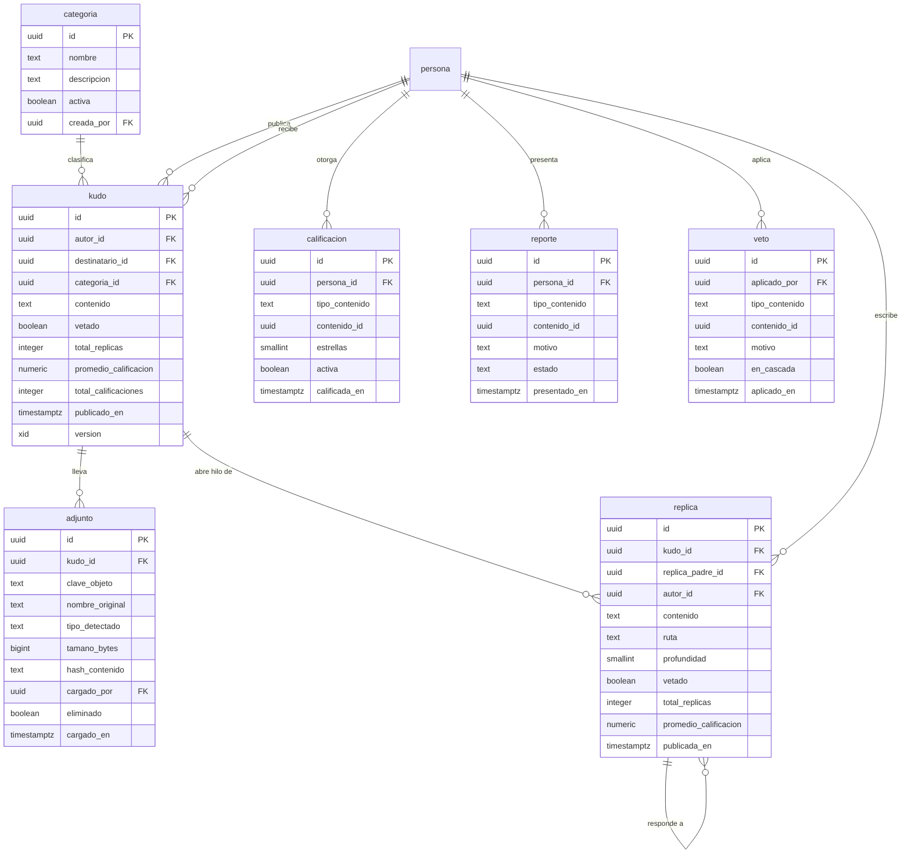
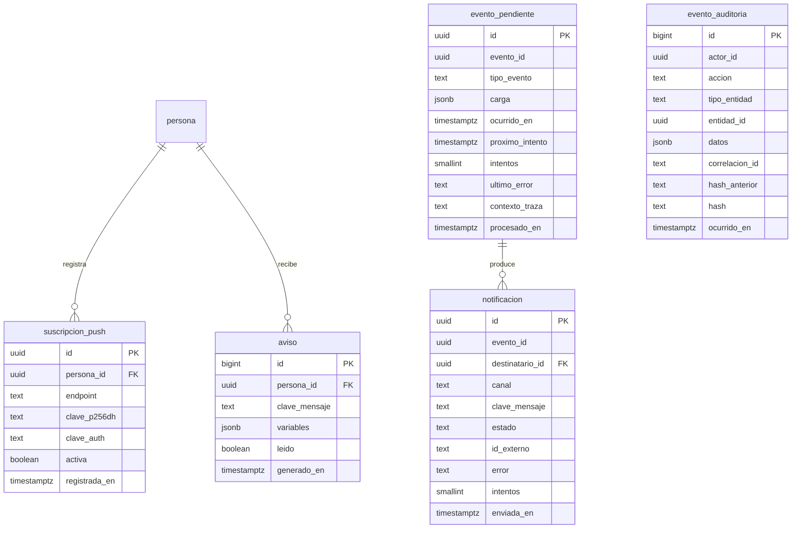

# Modelo de datos — UCO Kudos

Modelo entidad-relación de la plataforma. Es **diseño**: a la fecha de este documento el esquema no está implementado (ADR-0019 declara el alcance). Las decisiones de modelado salen de ADR-0003 (persistencia), ADR-0005 (bandeja de eventos), ADR-0011 (árbol de réplicas), ADR-0012 (adjuntos) y ADR-0013 (auditoría).

## Convenciones

| Convención | Razón |
|---|---|
| Nombres en `snake_case` | Evita las comillas dobles en SQL que exige PostgreSQL con identificadores en mayúsculas |
| Instantes en UTC | Un instante es un punto en el tiempo; la zona es presentación |
| Enumeraciones guardadas como texto | Un volcado de la base se lee sin consultar el código |
| Claves primarias ordenables en el tiempo | Los índices no se fragmentan al insertar, como sí ocurre con identificadores aleatorios |
| Cuatro esquemas: `nucleo`, `interaccion`, `notif`, `audit` | Separa responsabilidades y permite dar permisos distintos |

## 1. Identidad y estructura académica

Responde a RF-01 a RF-05 y sostiene la autorización de ADR-0004.

### Invariantes que defiende la base, no la aplicación

Son las reglas de RF-04 y RN-04. Una validación en la aplicación no resiste dos peticiones simultáneas; un índice único sí (ADR-0003).

| Invariante | Mecanismo |
|---|---|
| Una persona tiene **un** rol activo (RN-04) | Índice único parcial sobre `asignacion_rol (persona_id)` donde `activa` |
| **Un** Rector y **un** Coordinador Académico activos | Índice único parcial sobre `asignacion_rol (rol_id)` donde `activa` y el rol es de ámbito universidad |
| **Un** Coordinador de Facultad activo por facultad | Índice único parcial sobre `(rol_id, facultad_id)` donde `activa` |
| **Un** Coordinador de Programa activo por programa | Índice único parcial sobre `(rol_id, programa_id)` donde `activa` |
| El correo institucional es único | Índice único sobre `persona (correo_institucional)` |
| El ámbito corresponde al rol | Restricción de comprobación: un rol de ámbito programa exige `programa_id` no nulo, y uno de universidad lo exige nulo |
| La cuenta se activa solo con las tres condiciones (RF-02) | Restricción de comprobación: `estado_cuenta = 'Activa'` exige `correo_verificado` y `celular_verificado` |

`rol` es una tabla de catálogo con filas sembradas por migración: los siete roles del enunciado, con su `nivel` (que determina quién aprueba a quién, RF-03) y sus dos banderas de autorización (RF-06 y RF-12). Tenerlas como datos y no como condicionales dispersos es lo que permite probar la jerarquía con pruebas unitarias (ADR-0004).

## 2. Kudos, adjuntos e interacción

Responde a RF-06 a RF-13.

### Decisiones de modelado que conviene poder explicar

**`contenido` sin límite de longitud** (RN-03). En PostgreSQL `text` no tiene límite práctico, así que no hace falta nada especial. No se necesita un motor documental por esto.

**`ruta` y `profundidad` en `replica`** (ADR-0011). `replica_padre_id` es la verdad de la estructura y da integridad referencial; `ruta` es un dato derivado con los identificadores de los ancestros, indexado para búsqueda por prefijo. Con eso, leer un hilo completo de cualquier profundidad es **una** consulta, el orden por `ruta` ya es el orden anidado de presentación, y vetar en cascada es una sola operación. `profundidad` se guarda para no tener que contar separadores al pintar.

**Contadores en `kudo` y `replica`** (`total_replicas`, `promedio_calificacion`, `total_calificaciones`). Son datos derivados, mantenidos en la misma transacción que la réplica o la calificación que los cambia (ADR-0010). Convierten la agregación más costosa del muro en la lectura de una columna. El riesgo es que queden desfasados: hay una consulta de verificación que los compara con el valor real, usada en las pruebas de integración.

**`version` en `kudo`** es el token de concurrencia optimista (ADR-0005), mapeado a la columna de sistema del motor.

**Calificación y reporte apuntan a un contenido polimórfico** (`tipo_contenido` + `contenido_id`), porque el enunciado permite calificar y reportar tanto Kudos como réplicas (RF-10, RF-11). Es una referencia que la base no puede comprobar con una clave externa; se valida en el dominio y se cubre con pruebas. La alternativa, dos columnas excluyentes con dos claves externas, da integridad referencial a cambio de duplicar cada consulta: para dos tipos de contenido se eligió la forma simple, y se declara la contrapartida.

**Una calificación activa por usuario y contenido** (RF-10): índice único parcial sobre `(persona_id, tipo_contenido, contenido_id)` donde `activa`. Cambiar una calificación desactiva la anterior en lugar de editarla, de modo que quede el histórico.

**`adjunto` guarda metadatos, nunca el archivo** (ADR-0012). `clave_objeto` es el identificador generado en el almacenamiento, distinto de `nombre_original`, que es lo que escribió el usuario y solo se usa para mostrar. `hash_contenido` sirve para verificar integridad al restaurar y para detectar duplicados. `eliminado` marca en lugar de borrar: un borrado accidental es reversible.

**Las 15 categorías del enunciado se siembran por migración**, no se crean a mano: una base recién levantada debe quedar usable.

## 3. Notificaciones y auditoría

Responde a RF-14 a RF-17. Es el esquema que sostiene la funcionalidad obligatoria.

### Decisiones de modelado

**`evento_pendiente` es la bandeja de salida** (ADR-0005). Se escribe en la misma transacción que el Kudo. `proximo_intento` permite tanto el reintento con espera creciente como los eventos programados, sin un planificador aparte. El proceso en segundo plano toma filas con `FOR UPDATE SKIP LOCKED`, así que varias instancias no se pisan. `contexto_traza` guarda el contexto de la petición que originó el evento, para que la traza cruce la frontera asíncrona (ADR-0014): es lo que hace posible QA-OBS-01.

**`notificacion` da la idempotencia** (QA-CONF-02): índice único sobre `(evento_id, destinatario_id, canal)`. Reprocesar un evento no genera un segundo correo ni un segundo WhatsApp, porque la inserción falla. `id_externo` guarda el identificador que devuelve el proveedor, que es la evidencia de envío que pide la entrega.

**`aviso` persiste las notificaciones en tiempo real** (ADR-0009). Un canal en vivo es efímero: si el destinatario no estaba conectado y no tenía suscripción, el aviso sigue aquí y lo ve al entrar. La clave primaria es una secuencia numérica, no un identificador aleatorio, porque el envío en vivo necesita saber qué avisos son posteriores al último entregado.

**`suscripcion_push` se depura.** Cuando el servicio del navegador responde que una suscripción ya no es válida, se marca inactiva. Una tabla de suscripciones muertas genera fallos permanentes en cada publicación.

**`evento_auditoria` es de solo inserción, garantizado por un disparador** (ADR-0013). No es una convención del código: ni la propia aplicación puede actualizar ni borrar. `hash_anterior` y `hash` forman la cadena que hace la inmutabilidad **demostrable**: alterar o eliminar un evento intermedio rompe la cadena y lo detecta la operación de verificación. `datos` registra qué cambió, no necesariamente los valores: al cambiar un correo se guardan los campos afectados y no las direcciones, porque la auditoría es permanente y meter datos personales innecesarios crea un problema perpetuo.

## 4. Índices que sostienen los escenarios de rendimiento

Diseñados a partir de las consultas reales, no al revés (ADR-0003, ADR-0010). Son los que hay que mostrar para justificar QA-REND-01.

| Índice | Consulta que atiende |
|---|---|
| `kudo (publicado_en DESC, id DESC)` donde no vetado | Muro general con paginación por cursor |
| `kudo (destinatario_id, publicado_en DESC)` donde no vetado | Kudos recibidos por una persona |
| `kudo (categoria_id, publicado_en DESC)` donde no vetado | Muro filtrado por categoría |
| `replica (kudo_id, ruta)` | Hilo completo de un Kudo en una consulta |
| `replica (ruta text_pattern_ops)` | Búsqueda por prefijo para el veto en cascada |
| `evento_pendiente (proximo_intento, ocurrido_en)` donde no procesado | La vuelta del proceso de notificaciones |
| `evento_auditoria (correlacion_id)` | Reconstruir una publicación concreta (QA-OBS-01) |
| `evento_auditoria (entidad_id, ocurrido_en DESC)` | Historial de un contenido |
| `persona (correo_institucional)` único | Resolver el usuario interno en cada petición (ADR-0004) |

Los índices parciales «donde no vetado» importan: el muro nunca muestra contenido vetado, así que incluirlo en el índice sería espacio que ninguna consulta recorre.

## 5. Lo que este modelo no incluye

Por el alcance declarado en ADR-0019: la verificación del celular por código de un solo uso guarda su estado en una tabla que llegará con esa funcionalidad, y no hay tablas de reportes ni de indicadores porque los reportes están fuera del alcance. El modelo sí prevé ya las tablas de los niveles 2 y 3, porque prever una tabla es barato y migrar el esquema con prisa el último día no lo es.
