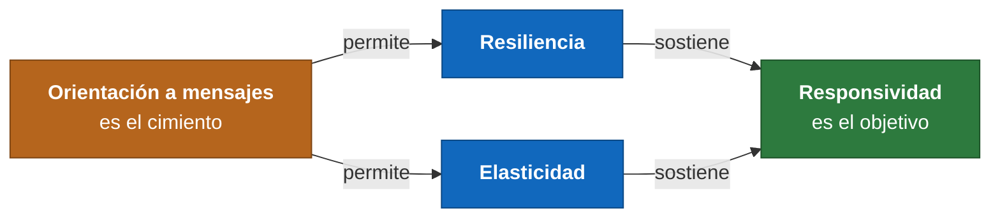

# Manifiesto de Sistemas Reactivos

El enunciado pide analizar y justificar cómo la solución aborda los cuatro rasgos del manifiesto: **responsividad, resiliencia, elasticidad y orientación a mensajes**.

Conviene empezar por el orden, porque el manifiesto no es una lista de cuatro cosas independientes. Su tesis es una cadena:



En esta plataforma esa cadena tiene un punto concreto donde se materializa: **la bandeja de eventos de ADR-0005**. Es la pieza que hace que los cuatro rasgos pasen de ser una afirmación del documento a un mecanismo que se puede señalar en el código. Por eso aparece en los cuatro apartados.

---

## 1. Orientación a mensajes

> *Los sistemas reactivos se apoyan en el paso de mensajes asíncrono para establecer una frontera entre componentes que garantiza bajo acoplamiento, aislamiento y transparencia de ubicación.*

### Cómo se aborda

El caso de uso que publica un Kudo **no llama a los tres canales de aviso**. Deposita un evento en una tabla y devuelve el control:

```text
PublicarKudoCasoUso  →  INSERT evento_pendiente (KudoPublicado)   [misma transacción]
                                    ╷
                         frontera asíncrona
                                    ╵
ProcesoNotificaciones  →  toma el evento  →  GatewayNotificaciones  →  3 adaptadores
```

Las propiedades que el manifiesto pide, una por una:

| Propiedad | Cómo se consigue aquí |
|---|---|
| **Bajo acoplamiento** | El emisor no sabe que existen tres canales. Añadir un cuarto es un adaptador más y una fila en la política (ADR-0006), sin tocar el módulo de Kudos |
| **Aislamiento** | Un fallo en el envío de WhatsApp no alcanza la transacción que ya confirmó el Kudo. Son dos unidades de trabajo distintas |
| **Transparencia de ubicación** | El emisor escribe en una tabla, no invoca a un destinatario. Si mañana el proceso de notificaciones corriera en otra máquina, el emisor no cambiaría |
| **No bloqueo** | Quien publica no espera a ningún proveedor externo |

### La decisión que hubo que tomar aquí

El manifiesto habla de paso de mensajes, y la lectura habitual es «hace falta un broker». Aquí se descartó, y es una decisión que conviene poder defender: **la cola es una tabla de PostgreSQL**.

El argumento es que lo que el manifiesto exige es la **frontera asíncrona** y sus propiedades, no un producto concreto. La bandeja las da todas, y además da una que un broker externo **no** puede dar: la atomicidad entre el cambio de estado y la publicación del mensaje, porque los dos se escriben en la misma transacción. Con un broker aparte reaparece la ventana «commit exitoso, mensaje no publicado».

El costo de la decisión está identificado: usar la base como cola no escala indefinidamente, la bandeja está detrás de un puerto y el punto de cambio está nombrado (ADR-0005).

---

## 2. Resiliencia

> *El sistema se mantiene responsivo frente al fallo. La resiliencia se logra mediante replicación, contención, aislamiento y delegación. Los fallos se contienen en cada componente.*

### Cómo se aborda

**Contención y aislamiento.** El escenario QA-DISP-01 es literal: Meta devuelve 503 al publicar un Kudo. Lo que ocurre es que el Kudo **queda publicado y auditado**, el correo y el push **salen igual**, y solo el WhatsApp se reintenta. Un canal caído degrada el servicio; no lo interrumpe. El fallo está contenido en el adaptador que lo sufrió.

**Delegación.** El fallo no se maneja donde ocurre. El adaptador clasifica el error y **delega la recuperación** al proceso de la bandeja, que es quien decide reintentar:

| Clase de error | Qué hace |
|---|---|
| Tiempo de espera, 429, 5xx, fallas de red → **transitorio** | El evento vuelve a la cola con espera creciente |
| El resto → **permanente** | Se registra el fallo y no se reintenta: reintentar un número inválido mil veces no lo vuelve válido |

Esa clasificación importa. Un sistema que reintenta todo indefinidamente no es resiliente, es un sistema que no distingue entre un problema pasajero y uno definitivo.

**Recuperación ante la muerte del proceso.** Es el caso más exigente, QA-CONF-01: el proceso muere **después** de confirmar el Kudo y **antes** de enviar los avisos. Como el evento se marca procesado dentro de la misma transacción en que se atiende, al morir la transacción se deshace, el bloqueo se libera y el evento queda pendiente. Al reiniciar se vuelve a tomar. **Ninguna notificación se pierde**, y es demostrable con una prueba que mate el proceso en ese punto exacto.

**Degradación elegante en el tiempo real.** Si el destinatario no está conectado y no tiene suscripción de push, el aviso **queda persistido** y lo ve al entrar (ADR-0009). El sistema no promete algo que no puede cumplir: cambia la inmediatez, no la entrega.

**Detección de fallos.** Se miden eventos pendientes, antigüedad del más viejo, envíos fallidos por canal y eventos descartados (ADR-0014). Una bandeja que crece es el primer síntoma de que un proveedor dejó de responder, antes de que alguien se queje.

### Lo que no se aborda, y hay que decirlo

**No hay replicación.** El manifiesto la nombra como uno de los cuatro medios, y aquí hay una sola máquina y una sola instancia: si la máquina cae, la plataforma cae (ADR-0016). La mitigación es el respaldo probado de la base y del volumen de objetos, pero eso es recuperación, no resiliencia. Es la limitación más honesta de este análisis y viene del presupuesto cero (RT-07).

---

## 3. Elasticidad

> *El sistema se mantiene responsivo bajo cargas de trabajo variables. Reacciona a los cambios en la tasa de entrada aumentando o disminuyendo los recursos asignados.*

### Cómo se aborda

Es el rasgo más débil de la línea base, y conviene separar dos cosas: **el diseño lo permite y el despliegue no lo ejerce**.

**Lo que el diseño ya resuelve:**

| Mecanismo | Qué habilita |
|---|---|
| **Sin estado de sesión en el proceso** (factor VI) | Dos instancias atenderían peticiones alternas sin que nadie lo note. La autenticación es por token y el usuario se resuelve en cada petición |
| **`FOR UPDATE SKIP LOCKED` en la bandeja** | Varias instancias del trabajador nunca toman el mismo evento, así que no se duplican envíos. Es QA-ELAS-01 y es verificable con una prueba |
| **La separación web / trabajador** | Los dos tipos de trabajo están identificados, que es el requisito previo para escalarlos por separado |
| **La caché detrás de un puerto** | Pasar a una caché distribuida es cambiar un adaptador, no rediseñar |

**Reacción a la carga sin añadir recursos.** Hay una forma de elasticidad que esta plataforma sí ejerce: ADR-0010 reduce el trabajo por petición en lugar de pedir más máquina. Los contadores materializados convierten una agregación sobre todo el árbol de réplicas en la lectura de una columna, y la paginación por cursor hace que la página 50 cueste lo mismo que la 1. Ante un pico de lectura en la semana de reconocimientos (QA-REND-02), el sistema no necesita crecer porque cada petición ya cuesta poco.

### Lo que no se aborda

**No hay escalado automático ni manual.** Una máquina, una instancia, y nada que observe la carga para ajustar recursos. Dos puntos concretos que habría que resolver antes de escalar, ya identificados:

1. La **caché en memoria** no se comparte entre instancias, y la invalidación por evento no llegaría a las demás.
2. Las **conexiones SSE** viven en la memoria de cada instancia, así que la política de «si está conectado, no enviar Web Push» no se podría coordinar sin un canal compartido.

Ninguno es estado de negocio, y los dos están anotados como puntos de revisión en lugar de descubrirse el día que haga falta.

---

## 4. Responsividad

> *El sistema responde a tiempo siempre que sea posible. La responsividad es la piedra angular de la usabilidad, y significa además que los problemas se detectan rápido y se tratan con eficacia.*

### Cómo se aborda

El manifiesto define la responsividad con dos mitades, y las dos importan aquí.

**Mitad uno: responder a tiempo.** Publicar un Kudo responde en cuanto la transacción confirma. **No se espera a ningún proveedor externo**: si los tres envíos fueran síncronos, el usuario esperaría a tres servicios de terceros en una red móvil, que es el escenario del 90 % de los usuarios (DRV-001). Esa es la razón de ser de la frontera asíncrona.

Para la lectura, que es la carga dominante (DRV-002), hay un objetivo medible y declarado:

| Escenario | Objetivo | Mecanismo |
|---|---|---|
| QA-REND-01 | P95 < 500 ms, P99 < 1,5 s en el servidor | Una consulta por pantalla, contadores materializados, caché por evento, índices diseñados desde las consultas |
| QA-REND-01 | Primera pantalla útil < 2,5 s en el cliente | PWA con armazón cacheado, presupuesto de peso por debajo de 300 KB |
| QA-REND-02 | Sin degradación con 200 usuarios concurrentes | La lectura no toca la ruta de escritura |

**Esos objetivos hay que medirlos, no suponerlos.** Hay una prueba de carga con datos sembrados que reporta los percentiles, y es la evidencia del escenario, no la afirmación de que se cumple.

**Límites consistentes en lugar de promesas vagas.** La paginación por cursor con tamaño acotado hace que ninguna consulta pueda devolver una cantidad arbitraria de datos: el tiempo de respuesta tiene un techo conocido, que es lo que el manifiesto pide cuando habla de tiempos de respuesta consistentes.

**Mitad dos: detectar y tratar los problemas rápido.** Es la parte que se suele olvidar del rasgo:

- Cada respuesta de error lleva el **identificador de traza** en formato estándar de problema HTTP, así que un usuario puede reportar un error con un identificador que lleva directo a la traza.
- La traza **cruza la frontera asíncrona**: el contexto se guarda en el evento y el proceso en segundo plano lo retoma. Eso es lo que permite reconstruir qué le pasó a **una** publicación concreta, que es QA-OBS-01. Sin esa propagación serían dos montones de registros sin relación.
- Los errores de negocio se traducen a respuestas comprensibles: 400 para una invariante, 409 para un conflicto de concurrencia, 403 para autorización. Un conflicto se le explica al usuario para que reintente, en lugar de sobrescribir en silencio.

**Lo que resta responsividad, declarado.** Las notificaciones son **eventualmente consistentes**: hay un retardo de segundos entre publicar y que llegue el correo. Es el precio de la frontera asíncrona y es una ganancia neta, porque lo que se compra con esos segundos es que publicar no dependa de tres servicios externos. Hay que decirlo al sustentar en lugar de presentar el sistema como instantáneo de punta a punta.

---

## 5. Resumen

| Rasgo | Evaluación | Mecanismo principal | Limitación declarada |
|---|---|---|---|
| **Orientación a mensajes** | Abordado | Bandeja de eventos en la misma transacción (ADR-0005) | Sin broker: la cola es una tabla, con el punto de cambio identificado |
| **Resiliencia** | Abordado en contención, aislamiento y delegación | Clasificación de errores, reintento con espera creciente, aviso persistido | **Sin replicación**: una sola máquina |
| **Elasticidad** | Habilitado por el diseño, no ejercido por el despliegue | Sin estado de sesión, `SKIP LOCKED`, caché tras un puerto | Sin escalado; caché y SSE en memoria del proceso |
| **Responsividad** | Abordado, con objetivos medibles | Frontera asíncrona, lado de lectura propio, traza propagada | Avisos eventualmente consistentes |

La conclusión honesta: la plataforma aplica el manifiesto en lo que depende del **diseño**, y queda corta en lo que depende de la **infraestructura**, por el presupuesto cero. Las dos limitaciones reales, sin replicación y sin escalado, vienen de desplegar en una sola máquina de capa gratuita, y en los dos casos el diseño no es lo que lo impide.
