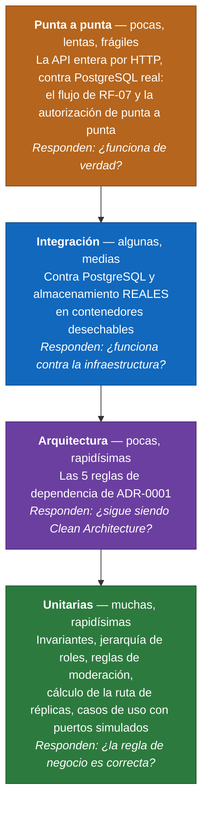

# Pirámide de pruebas

El enunciado exige pruebas automatizadas en tres niveles como mínimo: unitarias, de integración y de punta a punta. Esta plataforma tiene **cuatro**, porque las de arquitectura son un nivel propio con un propósito distinto.

## 1. La forma de la pirámide



La forma importa: **muchas abajo y pocas arriba**. Una suite invertida, con muchas pruebas de punta a punta y pocas unitarias, tarda media hora, falla por razones que no son el código y acaba desactivada.

## 2. Qué se prueba en cada nivel, y por qué ahí

### Unitarias — la base

Prueban **reglas de negocio sin ninguna infraestructura**: ni base de datos, ni red, ni reloj del sistema.

| Qué se prueba | Por qué aquí |
|---|---|
| Invariantes de las entidades | Se validan en el constructor, así que basta intentar construir una instancia inválida |
| `JerarquiaInstitucional`: quién aprueba a quién y quién manda sobre quién | Es la parte más característica del enunciado (RF-03, RF-04, RF-06, RF-12). Se prueba con una tabla de casos que recorre las **seis filas** del flujo de aprobaciones, incluida la del Administrador que se aprueba a sí mismo |
| Reglas de moderación | Que solo Rector y Coordinador Académico puedan vetar es una regla, no una consulta |
| Cálculo de la ruta de una réplica | Es aritmética de cadenas: el nivel perfecto para probar el caso del prefijo que coincide parcialmente |
| Casos de uso con los puertos simulados | Verifica la orquestación sin los proveedores |
| Jerarquía de excepciones | La capa de interfaces captura `ExcepcionDominio`; si una especializada dejara de heredar de ella, un error previsto saldría como 500 |

**Lo que hace posible este nivel** es la decisión de ADR-0001 de que el dominio no dependa de nada, y la regla de que **el tiempo entra como parámetro**: sin ella, probar «la calificación venció» exigiría esperar.

**Umbral de cobertura:** se mide sobre `Domain` y `Application`, que es donde está la lógica, no sobre la solución completa. Medir cobertura de la infraestructura premia escribir pruebas de adaptadores con dobles, que no prueban nada útil. Arranca en 0 y sube a 80 % de líneas y 70 % de ramas con el primer caso de uso.

### Arquitectura — el nivel propio

Prueban que la estructura **siga siendo** la que los ADR describen. Es el único nivel cuyo sujeto no es el comportamiento sino la forma.

Las cinco reglas de ADR-0001, con un reparto que conviene tener claro al sustentar:

| Regla | Quién la garantiza |
|---|---|
| 1. El dominio no depende de ninguna otra capa | **El compilador**, porque el proyecto no tiene referencias. La prueba la guarda para que nadie añada una |
| 2. La aplicación depende solo del dominio | El compilador, igual |
| 3. La infraestructura no conoce la capa de interfaces | El compilador, igual |
| **4. La API solo usa puertos de entrada y DTO** | **Solo esta prueba.** La API referencia la infraestructura para su raíz de composición, así que el compilador lo permite |
| 5. El núcleo no referencia tecnología de persistencia | Una prueba por reflexión sobre los ensamblados referenciados |

**La regla 4 es la que justifica este nivel.** Decir que las cinco dependen de ArchUnit sería exagerado; decir la verdad es más defendible.

**La disciplina obligatoria:** cada regla nueva se comprueba **provocando a propósito una violación**. Una regla que nunca ha fallado no está verificada, y es muy fácil escribir una que no detecta nada. La regla 4 se verificó así: se añadió un uso de la infraestructura fuera de la raíz de composición, falló solo esa prueba, y volvió a verde al retirarlo.

### Integración — contra infraestructura real

Prueban lo que **solo se puede probar contra la infraestructura de verdad**, en contenedores desechables que la propia prueba levanta.

| Qué se prueba | Por qué un doble en memoria no sirve |
|---|---|
| **Índices únicos parciales** (RF-04, QA-SEG-03) | Una base en memoria no reproduce un índice único parcial. Dos intentos simultáneos de nombrar Rector tienen que fallar **en la base** |
| **`FOR UPDATE SKIP LOCKED`** de la bandeja | El comportamiento del bloqueo es del motor. Dos procesos compitiendo por la misma cola deben producir cero envíos duplicados |
| **Idempotencia de las notificaciones** (QA-CONF-02) | El índice único sobre evento, destinatario y canal es lo que la garantiza |
| **Recuperación tras la muerte del proceso** (QA-CONF-01) | Se mata el proceso entre el commit y el envío, y al reiniciar el aviso debe salir **una** vez |
| **La cadena de hashes de la auditoría** | El motor trunca la precisión de la fecha y reordena las claves del JSON. Sin probarlo contra la base real, la verificación fallaría al releer aunque nada se hubiera alterado |
| **URL prefirmada y su expiración** (QA-SEG-02) | La firma y el vencimiento los implementa el almacenamiento |
| **La ruta de réplicas y el veto en cascada** | La búsqueda por prefijo depende del índice y del ordenamiento de texto |
| **Los contadores materializados** | Una consulta de verificación los compara con el valor real sobre un árbol sembrado |
| **La autorización de la API** | Que un Coordinador de Programa reciba 403 al crear una categoría se prueba con la aplicación levantada |

**Las pruebas negativas son las que importan aquí.** La prueba de seguridad de los adjuntos no es que la descarga funcione, sino que **falle**: pedir el objeto sin firma debe ser rechazado, y una URL expirada también. Sin esas dos, la estrategia de seguridad de ADR-0012 es una afirmación.

**Trampa conocida del pipeline:** toda clase de este proyecto debe llevar la marca de categoría o el CI **no la ejecuta** y el pipeline sigue en verde sin haberla corrido. Es el fallo más peligroso porque no se ve.

### Punta a punta — la cima

Pocas y centradas en el flujo obligatorio. El escenario principal:

```text
Iniciar sesión
  → publicar un Kudo con un adjunto
  → comprobar que el Kudo aparece en el muro
  → comprobar que se registraron los tres envíos
  → comprobar que la auditoría tiene el evento de publicación
```

Con los adaptadores simulados de los canales, para no depender de la red ni gastar cuota. Que **se registraron** los envíos es lo que se verifica, no que un celular real recibió el mensaje: eso es la evidencia manual de la entrega.

**Se mantienen pocas a propósito.** Son las más frágiles de la suite, y una cima inflada es lo que convierte una suite útil en una que todos ignoran.

## 3. Qué se verifica fuera de la pirámide

Hay dos verificaciones que no son pruebas de la pirámide y sin las cuales dos escenarios quedarían sin evidencia:

| Verificación | Qué escenario respalda | Por qué no es una prueba normal |
|---|---|---|
| **Prueba de carga** con datos sembrados (del orden de 10 000 Kudos y sus réplicas), que reporta percentiles | QA-REND-01 y QA-REND-02 | Afirmar que se responde a DRV-002 sin medirlo es una suposición. El resultado es la evidencia |
| **Prueba de restauración** del respaldo de la base **y** del volumen de objetos, juntos | La estrategia de recuperación de ADR-0012 | Un respaldo nunca probado es un respaldo que no existe. Y restaurar uno sin el otro deja Kudos que apuntan a adjuntos inexistentes |

Y dos del cliente web, que corren en su propio repositorio: pruebas de componentes con **verificación automática de accesibilidad** (un control sin nombre accesible falla la construcción) y los **presupuestos de peso y de primera pantalla** de QA-MOV-01. Un presupuesto que no falla la construcción no es un presupuesto.

## 4. Cómo se ejecutan

```bash
./scripts/pruebas.ps1
```

```bash
./scripts/pruebas.ps1 -Proyecto integracion
```

Las pruebas corren **dentro de un contenedor Linux**. En el equipo de desarrollo, Smart App Control está activo en modo bloqueo y rechaza cargar ensamblados recién compilados sin reputación, así que el ejecutor de pruebas muere antes de la primera prueba. El contenedor lo evita sin desactivar ninguna protección del sistema, que además sería irreversible.

Tiene un segundo beneficio, que es el que importa para la paridad de entornos: **el CI invoca el mismo script**, así que un resultado local y uno del pipeline son comparables y el umbral de cobertura está definido en un único lugar.

Las de integración levantan sus propios contenedores, así que necesitan Docker disponible; el script lo comprueba y avisa.

## 5. Trazabilidad: cada escenario de calidad con su prueba

Es la tabla que hay que poder mostrar: ningún escenario de calidad debería quedar sin una prueba que lo respalde.

| Escenario | Nivel que lo prueba | Prueba |
|---|---|---|
| QA-REND-01 Muro con 10 000 Kudos, P95 < 500 ms | Fuera de la pirámide | Prueba de carga con percentiles |
| QA-REND-02 200 usuarios concurrentes | Fuera de la pirámide | Prueba de carga |
| QA-MOV-01 Presupuestos del cliente | Cliente web | Presupuesto de peso y de primera pantalla, bloqueantes |
| QA-CONF-01 Ninguna notificación se pierde | Integración | Muerte del proceso entre el commit y el envío |
| QA-CONF-02 Un reproceso no duplica | Integración | Reproceso del mismo evento; el índice único lo impide |
| QA-DISP-01 Meta caída no impide publicar | Integración | Adaptador que devuelve 503; el Kudo queda publicado |
| QA-SEG-01 Coordinador de Programa recibe 403 | Integración | Autorización de la API, con auditoría del intento |
| QA-SEG-02 URL de adjunto vencida | Integración | **Prueba negativa**: la descarga debe fallar |
| QA-SEG-03 Segundo Rector activo imposible | Integración | Índice único parcial, con dos intentos simultáneos |
| QA-OBS-01 Reconstruir una publicación | Manual, con evidencia | Publicar, tomar el identificador de traza y encontrar petición, transacción, evento y envíos en una sola vista |
| QA-MANT-01 Cambiar de proveedor | Arquitectura + integración | Las reglas de dependencia, y los tres adaptadores sustituibles del puerto de correo |
| QA-ELAS-01 Dos instancias no duplican | Integración | Dos procesos compitiendo por la misma cola |

**Las tres pruebas no negociables**, porque son la evidencia de los escenarios más delicados: que un reproceso no duplique notificaciones (QA-CONF-02), que una URL prefirmada expirada sea rechazada (QA-SEG-02) y que el segundo Rector activo sea imposible (QA-SEG-03).

## 6. Estado actual

| Nivel | Pruebas | Estado |
|---|---|---|
| Unitarias | 3 | La jerarquía de excepciones. Crecen con el dominio |
| Arquitectura | 6 | **Las cinco reglas de ADR-0001, con la regla 4 verificada provocando una violación** |
| Integración | 0 | El proyecto está preparado y el camino al socket de Docker resuelto; no hay ninguna escrita |
| Punta a punta | 0 | Pendiente; llega con el flujo de RF-07 |

Lo honesto es decir que hoy la pirámide tiene la base y el nivel de arquitectura, y que los dos niveles superiores llegan con la funcionalidad. El andamiaje de los cuatro ya está en pie, que es lo que evita que las pruebas se dejen para el final.

---

## Lo que el nivel de punta a punta es, y lo que no es

**Es** un conjunto de escenarios que levantan la API completa en memoria con `WebApplicationFactory`,
contra PostgreSQL real, y hacen **peticiones HTTP** a sus endpoints. Atraviesan todo el camino de
una petición —enrutamiento, autenticación, autorización, serialización, manejo de errores— antes
de llegar al dominio, y eso es lo que las distingue de las de integración, que invocan casos de uso
con un contexto ya construido.

Se sustituye **una sola pieza**: la validación del token. En lugar de comprobar una firma contra el
proveedor de identidad, la identidad se lee de una cabecera, y el correo viaja en el mismo claim que
pone el proveedor real. Todo lo demás es el sistema auténtico, incluida la resolución del rol contra
la base en cada petición. Validar tokens reales obligaría a que el pipeline tuviera credenciales de
un tercero, y una prueba que depende de la disponibilidad de otro falla por razones que no son suyas.

**No es** una prueba dirigida desde un navegador. Un escenario de interfaz con Playwright sobre el
sitio desplegado exigiría iniciar sesión en el proveedor de identidad, y eso significa credenciales
reales en el pipeline. Queda declarado como ausente: la interfaz se cubre con pruebas de componentes
y con la verificación manual que consta en `docs/evidencias`.

### Escenarios

| Escenario | Qué impide |
|---|---|
| Publicar un Kudo cumple los cinco pasos del enunciado | Que alguno de los cinco efectos deje de ocurrir, o que ocurra antes de tiempo: el correo y el WhatsApp **no** salen hasta que pasa el despachador |
| Una petición sin identidad recibe 401 | Que una ruta quede abierta |
| Una identidad sin cuenta, o con cuenta no activa, no puede leer | Que autenticarse se confunda con tener cuenta |
| Reconocerse a uno mismo es un 400 que explica el motivo | Que el motivo se pierda por el camino |
| La auditoría solo la consulta un rol de universidad | Que la autorización dependa de la pantalla |
| El buscador encuentra sin tildes y no expone datos de contacto | Que una caja de búsqueda sea un volcado del directorio |

### Hallazgo de este nivel

La primera ejecución destapó un fallo de seguridad que ninguna prueba anterior había visto: **el
muro, los Kudos recibidos, el detalle, las réplicas y las categorías solo exigían un token válido,
no una cuenta**. Con inicio de sesión social, cualquier persona con una cuenta de Google podía leer
todos los reconocimientos de la universidad, y una cuenta desactivada seguía leyendo, contra lo que
el propio código de la API afirma. Se corrigió con un filtro de endpoint
(`ExigirCuentaActiva`) y los escenarios quedan como regresión.
